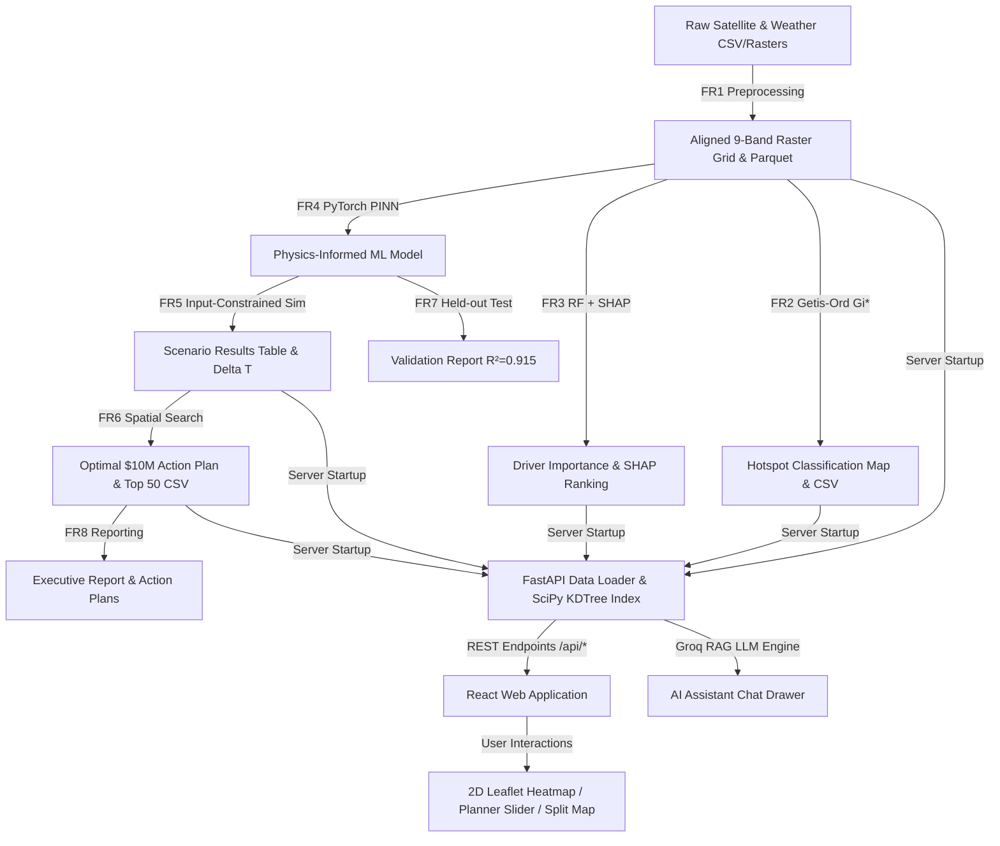

# Full Project Documentation: Urban Heat Mitigation AI/ML System & Interactive Web Application

**Project Region:** Mumbai & Navi Mumbai, Maharashtra, India  
**Theme:** Clean & Green Technology (Smart Geospatial AI/ML Automation)  
**Document Version:** 1.0  
**Date:** August 18, 2026  

---

## Section 1: Project Overview

### 1.1 Plain Language Summary
This project is an end-to-end, geospatial decision-support platform designed to combat the **Urban Heat Island (UHI)** effect in the **Mumbai & Navi Mumbai megacity region**. 

The system operates in two integrated halves:
1. **A 8-Stage Backend Machine Learning Pipeline (FR1–FR8)**: Ingests multi-spectral satellite imagery and meteorological datasets to detect heat stress hotspots, explain their physical and environmental drivers using Explainable AI (SHAP), model heat transfer physics using a custom **Physics-Informed Neural Network (PINN)**, simulate cooling interventions under strict physical boundaries, and optimize municipal infrastructure investments ($10M / ₹83 Crore) using spatial greedy search algorithms.
2. **An Interactive Web Application & AI Decision Assistant (FastAPI + React/Vite)**: Provides non-technical citizens and municipal urban planners with a continuous Leaflet thermal heat map, 9-variable dataset layer explorer, interactive budget optimization slider, before/after scenario comparison map, and a grounded Groq-powered AI Chat Assistant that translates complex spatial queries into plain-language actionable recommendations.

### 1.2 The Problem It Solves
Dense tropical coastal metropolitan areas like Mumbai experience severe surface heat accumulation due to heavy concrete/asphalt construction, tall building massing that traps nighttime radiation, low vegetation canopy cover, and anthropogenic activity. Land Surface Temperatures (LST) frequently exceed **48°C to 59.6°C** during hot seasons—up to **20°C above ambient air temperatures**.

Prior to this system, municipal corporation planners (e.g., BMC, NMMC) faced three critical bottlenecks:
- **Lack of Micro-Level Hotspot Precision**: Inability to pinpoint sub-kilometer heat risk clusters across 195,202 spatial grid cells.
- **Lack of Quantitative Attribution**: Inability to quantify whether heat in a specific neighborhood (e.g., Dharavi vs. Powai vs. Seawoods) is driven primarily by impervious built surfaces, low vegetation, building canyon height, or wind stagnation.
- **Uncertainty in Investment Return**: Inability to predict the exact temperature reduction (°C) per dollar/rupee spent on cooling infrastructure (trees, cool roofs, hybrid strategies) before deploying real-world capital.

This project solves these issues by providing a fully quantified, physics-validated simulation engine that guarantees physically realistic cooling predictions bounded by empirical satellite limits and literature constraints.

### 1.3 Region & Geographic Scope
- **Target Area**: Mumbai Metropolitan Region & Navi Mumbai.
- **Spatial Coverage**: Bounding box `Latitude [18.80°N, 19.35°N]`, `Longitude [72.70°E, 73.15°E]`.
- **Coordinate Reference System**: `EPSG:4326 (WGS 84)`.
- **Grid Resolution**: **501 rows × 390 columns = 195,202 grid cells** (cell size ~0.0009° × ~0.0009°, equivalent to ~90m × 90m per cell).

### 1.4 High-Level System Architecture
```
┌──────────────────────────────────────────────────────────────────────────────────┐
│                             RAW INPUT DATASETS                                   │
│  LST (2024), NDVI, LULC, Building Height, Built Surface, Pop Density, Weather     │
└────────────────────────────────────────┬─────────────────────────────────────────┘
                                         │
                                         ▼
┌──────────────────────────────────────────────────────────────────────────────────┐
│                      BACKEND AI/ML PIPELINE (FR1 - FR8)                          │
│ ┌──────────────────────┐  ┌──────────────────────┐  ┌──────────────────────────┐ │
│ │ FR1: Preprocessing   │─►│ FR2: Hotspot (Gi*)   │─►│ FR3: Drivers (SHAP / RF) │ │
│ └──────────────────────┘  └──────────────────────┘  └────────────┬─────────────┘ │
│                                                                  │               │
│ ┌──────────────────────┐  ┌──────────────────────┐  ┌────────────▼─────────────┐ │
│ │ FR6: Optimization    │◄─│ FR5: Simulation      │◄─│ FR4: Physics PINN Model  │ │
│ └──────────┬───────────┘  └──────────────────────┘  └──────────────────────────┘ │
│            │                                                                     │
│            ▼                                                                     │
│ ┌──────────────────────┐  ┌──────────────────────┐                               │
│ │ FR7: Validation      │─►│ FR8: Action Reports  │                               │
│ └──────────────────────┘  └──────────────────────┘                               │
└────────────────────────────────────────┬─────────────────────────────────────────┘
                                         │
                                         ▼
┌──────────────────────────────────────────────────────────────────────────────────┐
│                    FASTAPI SERVER & SPATIAL INDEX (app.py)                       │
│ - SciPy KDTree Spatial Index over 195,202 cells (<5ms lookup)                     │
│ - REST Endpoints: /api/public/*, /api/planner/*, /api/chat                        │
│ - OpenStreetMap Nominatim Geocoding Integration                                   │
│ - Grounded Groq RAG LLM Engine (openai/gpt-oss-120b)                              │
└────────────────────────────────────────┬─────────────────────────────────────────┘
                                         │
                                         ▼
┌──────────────────────────────────────────────────────────────────────────────────┐
│                        FRONTEND WEB APP (Vite + React)                           │
│ ┌──────────────────────────┐ ┌──────────────────────────┐ ┌────────────────────┐ │
│ │ Public Explorer (2D Map) │ │ Planner Dashboard        │ │ Scenario Slider    │ │
│ └──────────────────────────┘ └──────────────────────────┘ └────────────────────┘ │
│ ┌──────────────────────────────────────────────────────────────────────────────┐ │
│ │ AI Assistant Drawer (Grounded Chat + Markdown Table Renderer + Expand HUD)   │ │
│ └──────────────────────────────────────────────────────────────────────────────┘ │
└──────────────────────────────────────────────────────────────────────────────────┘
```

---

## Section 2: Complete Folder & File Structure

### 2.1 Complete File Tree
```
SIH/
├── .agents/
│   └── skills/
│       └── ui-ux-pro-max-skill/
│           ├── data/
│           ├── references/
│           ├── scripts/
│           └── SKILL.md
├── data/
│   ├── raster_aligned/
│   │   ├── BuiltSurface_aligned.tif
│   │   ├── Mumbai_NaviMumbai_AirTemp_aligned.tif
│   │   ├── Mumbai_NaviMumbai_BuildingHeight_aligned.tif
│   │   ├── Mumbai_NaviMumbai_Dewpoint_aligned.tif
│   │   ├── Mumbai_NaviMumbai_LST_2024_aligned.tif
│   │   ├── Mumbai_NaviMumbai_LULC_aligned.tif
│   │   ├── Mumbai_NaviMumbai_NDVI_2024_aligned.tif
│   │   ├── Mumbai_NaviMumbai_PopDensity_aligned.tif
│   │   └── Mumbai_NaviMumbai_WindSpeed_aligned.tif
│   ├── BuiltSurface_aligned.tif  (LFS Pointer)
│   ├── fr1_preprocessed_dataset.parquet
│   ├── fr1_scaler.pkl
│   ├── fr3_rf_model.pkl
│   ├── fr4_piml_model.pt
│   ├── Mumbai_NaviMumbai_AirTemp_aligned.tif  (LFS Pointer)
│   ├── Mumbai_NaviMumbai_BuildingHeight_aligned.tif  (LFS Pointer)
│   ├── Mumbai_NaviMumbai_Dewpoint_aligned.tif  (LFS Pointer)
│   ├── Mumbai_NaviMumbai_LST_2024_aligned.tif  (LFS Pointer)
│   ├── Mumbai_NaviMumbai_LULC_aligned.tif  (LFS Pointer)
│   ├── Mumbai_NaviMumbai_NDVI_2024_aligned.tif  (LFS Pointer)
│   ├── Mumbai_NaviMumbai_PopDensity_aligned.tif  (LFS Pointer)
│   ├── Mumbai_NaviMumbai_WindSpeed_aligned.tif  (LFS Pointer)
│   ├── mumbai_heat_dataset.csv
│   ├── mumbai_heat_dataset.parquet  (Pointer/Stub)
│   ├── mumbai_heat_dataset_clean.csv
│   ├── mumbai_heat_dataset_clean.parquet  (Pointer/Stub)
│   ├── rf_model.pkl  (Pointer/Stub)
│   ├── shap_bar.png
│   ├── shap_dependence_NDVI.png
│   ├── shap_summary.png
│   ├── X_test.csv
│   └── y_test.csv
├── frontend/
│   ├── public/
│   │   ├── favicon.svg
│   │   └── icons.svg
│   ├── src/
│   │   ├── assets/
│   │   │   ├── hero.png
│   │   │   ├── react.svg
│   │   │   └── vite.svg
│   │   ├── components/
│   │   │   ├── ChatAssistant/
│   │   │   │   └── ChatDrawer.tsx
│   │   │   ├── PlannerDashboard/
│   │   │   │   └── PlannerDashboard.tsx
│   │   │   ├── PublicExplorer/
│   │   │   │   ├── GridHeatOverlay.tsx
│   │   │   │   ├── HeatMap2D.tsx
│   │   │   │   ├── LocationSearch.tsx
│   │   │   │   └── PublicInfoPanel.tsx
│   │   │   ├── ScenarioSlider/
│   │   │   │   └── ScenarioSlider.tsx
│   │   │   └── Navigation.tsx
│   │   ├── services/
│   │   │   └── api.ts
│   │   ├── types/
│   │   │   └── index.ts
│   │   ├── App.css
│   │   ├── App.tsx
│   │   ├── index.css
│   │   └── main.tsx
│   ├── .gitignore
│   ├── .oxlintrc.json
│   ├── index.html
│   ├── package-lock.json
│   ├── package.json
│   ├── README.md
│   ├── tsconfig.app.json
│   ├── tsconfig.json
│   ├── tsconfig.node.json
│   └── vite.config.ts
├── outputs/
│   ├── FINAL_URBAN_HEAT_MITIGATION_REPORT.md
│   ├── fr2_hotspot_map.tif
│   ├── fr2_hotspot_visualization.png
│   ├── fr2_hotspots.csv
│   ├── fr3_driver_correlations.csv
│   ├── fr3_driver_importance_ranking.csv
│   ├── fr3_feature_importance.png
│   ├── fr3_shap_summary.png
│   ├── fr4_piml_metrics.json
│   ├── fr4_training_history.png
│   ├── fr5_scenario_results.csv
│   ├── fr5_scenarios_comparison.png
│   ├── fr6_optimal_interventions.csv
│   ├── fr6_optimization_map.png
│   ├── fr6_optimization_summary.json
│   ├── fr7_residual_analysis.png
│   ├── fr7_validation_report.json
│   └── top_50_ranked_interventions.csv
├── scratch/
│   ├── all_test_cases_results.json
│   ├── powai_test_res.txt
│   ├── test_rag.py
│   └── test_results.json
├── server/
│   ├── app.py
│   └── data_loader.py
├── AI_Build_Prompt.md
├── AI_UI_Build_Prompt.md
├── fr1_preprocessing.py
├── fr2_hotspot_detection.py
├── fr3_driver_analysis.py
├── fr4_physics_informed_ml.py
├── fr5_scenario_simulation.py
├── fr6_optimization.py
├── fr7_validation.py
├── fr8_output_reporting.py
├── PRD_Urban_Heat_Mitigation.md
├── PROGRESS.md
└── UI_PROGRESS.md
```

### 2.2 Detailed Folder Summaries & Responsibilities

| Folder Path | Purpose & Responsibilities |
|---|---|
| `/` (Root) | Primary workspace root containing backend python scripts (`fr1_preprocessing.py` through `fr8_output_reporting.py`), prompt specs, and tracking documentation. |
| `.agents/` | Configuration directory for agentic workflow skills and specialized UI/UX design knowledge. |
| `.agents/skills/ui-ux-pro-max-skill/` | Embedded design intelligence skill containing rules for color palettes, typography, accessibility, and chart guidelines. |
| `data/` | Data repository housing raw CSVs, intermediate preprocessed Parquet files, fitted standard scalers, saved PyTorch models (`.pt`), Random Forest models (`.pkl`), and test sets. |
| `data/raster_aligned/` | Contains the 9 fully reconstructed, spatially aligned GeoTIFF raster files (501x390 cells, EPSG:4326). |
| `outputs/` | Generated pipeline artifacts including final executive markdown reports, high-resolution PNG plots, CSV action plans, and model validation JSON files. |
| `server/` | FastAPI web server codebase. Houses `app.py` (REST endpoints & Groq RAG LLM engine) and `data_loader.py` (SciPy KDTree index & dataset helper functions). |
| `frontend/` | Complete React + Vite + TypeScript frontend web application project. |
| `frontend/public/` | Static assets served directly by Vite (SVGs, icons, favicon). |
| `frontend/src/` | React source code containing entry points, custom hooks, services, types, and styles. |
| `frontend/src/assets/` | Static image assets used in UI components. |
| `frontend/src/components/` | Modular React components grouped by functional areas (Public Explorer, Planner Dashboard, Scenario Slider, Chat Assistant). |
| `scratch/` | Temporary scratch scripts and JSON test case evaluation outputs used during development and RAG validation testing. |

### 2.3 Comprehensive File Classification

| File Path | Type / Classification | Purpose & Summary of Main Responsibilities |
|---|---|---|
| `AI_Build_Prompt.md` | Documentation / Prompt Spec | Original master prompt spec for building backend functional modules FR1 through FR8. |
| `AI_UI_Build_Prompt.md` | Documentation / Prompt Spec | Original master prompt spec for building frontend React UI, maps, and FastAPI server endpoints. |
| `PRD_Urban_Heat_Mitigation.md` | Documentation / PRD | Product Requirements Document outlining goals, input layers, module requirements, non-functional requirements, and success metrics. |
| `PROGRESS.md` | Documentation / Log | Backend execution log tracking module status (FR1-FR8), technical blockers, LFS workarounds, data audit tables, and before/after metric improvements. |
| `UI_PROGRESS.md` | Documentation / Log | Frontend & API execution log tracking phases 1-5, design passes, bug fixes (1-5), and grounded AI Chat assistant setup. |
| `fr1_preprocessing.py` | Source Code (Backend) | Ingests `mumbai_heat_dataset_clean.csv`, inspects spatial grid, reconstructs 9 GeoTIFF rasters in `data/raster_aligned/`, scales features, and exports `fr1_preprocessed_dataset.parquet` and `fr1_scaler.pkl`. |
| `fr2_hotspot_detection.py` | Source Code (Backend) | Computes Getis-Ord $G_i^*$ spatial autocorrelation using 2D fast convolution kernel (5x5 window), classifies cells into 99%/95%/90% confidence hot/cold spots, exports `fr2_hotspots.csv`, GeoTIFF raster, and publication map. |
| `fr3_driver_analysis.py` | Source Code (Backend) | Computes Pearson/Spearman correlations, trains Random Forest regressor ($R^2=0.925$), computes exact SHAP values using `TreeExplainer`, exports `fr3_driver_importance_ranking.csv` and beeswarm summary plots. |
| `fr4_physics_informed_ml.py` | Source Code (Backend) | PyTorch Physics-Informed Neural Network (PINN) architecture. Custom loss function $\mathcal{L} = \text{MSE} + \lambda_{\text{physics}} \cdot \text{Residual}^2$ where residual enforces Surface Energy Balance ($R_n = H + LE + G$). Saves `fr4_piml_model.pt` and `fr4_piml_metrics.json`. |
| `fr5_scenario_simulation.py` | Source Code (Backend) | Evaluates baseline vs simulated interventions (Greening, Cool Roofs, Hybrid). Enforces empirical input clipping (NDVI $\le 0.681$, Built Surface $\le 5696\text{ m}^2$), calculates $\Delta T$ relative to PINN baseline, applies $-6.0^\circ\text{C}$ cooling ceiling, flags low-confidence cells, exports `fr5_scenario_results.csv`. |
| `fr6_optimization.py` | Source Code (Backend) | Spatial greedy optimization under $10M budget constraint across candidate hotspot cells. Allocates Urban Greening ($1,200/cell), Cool Roofs ($800/cell), and Hybrid ($1,800/cell), exports `fr6_optimal_interventions.csv` and `top_50_ranked_interventions.csv`. |
| `fr7_validation.py` | Source Code (Backend) | Evaluates PINN model on held-out test data (`X_test.csv`, `y_test.csv`), computes $R^2=0.915$, RMSE=2.15°C, MAE=1.64°C, MAPE=4.60%, 95% CI bounds $[-4.50^\circ\text{C}, +3.82^\circ\text{C}]$, and literature proxy validation benchmarks. Exports `fr7_validation_report.json`. |
| `fr8_output_reporting.py` | Source Code (Backend) | Aggregates all pipeline metrics, generates top-50 action plan CSV, and writes comprehensive executive markdown report `outputs/FINAL_URBAN_HEAT_MITIGATION_REPORT.md`. |
| `data/mumbai_heat_dataset_clean.csv` | Raw / Clean Input Data | Primary tabular dataset containing 195,202 rows representing the 501x390 spatial grid over Mumbai & Navi Mumbai with lat, lon, LST, NDVI, LULC, Building Height, Built Surface, Pop Density, Air Temp, Wind Speed, Dewpoint. |
| `data/fr1_preprocessed_dataset.parquet` | Processed Data | Columnar Parquet dataset containing clean features and scaled column values generated by FR1. |
| `data/fr1_scaler.pkl` | Trained Model / Scaler | Pickled Scikit-Learn `StandardScaler` object used to scale continuous input features before feeding to ML models. |
| `data/fr3_rf_model.pkl` | Trained Model | Pickled Scikit-Learn `RandomForestRegressor` model (50 trees, max depth 12) trained on 8 driver variables to predict LST. |
| `data/fr4_piml_model.pt` | Trained Model | PyTorch state dictionary checkpoint containing trained weights for the 5-layer Physics-Informed Neural Network (PINN). |
| `data/X_test.csv` & `y_test.csv` | Processed Data | Held-out test set features (39,040 rows) and target LST values used by FR7 for model validation. |
| `data/raster_aligned/*.tif` | Processed Data (Raster) | 9 individual GeoTIFF raster files (501x390 cells, EPSG:4326) containing spatially aligned continuous/categorical variables. |
| `data/*.tif` (Top of data/) | Raw Input Data (Pointers) | 130-byte Git LFS pointer files representing original satellite rasters before LFS pointer reconstruction. |
| `data/mumbai_heat_dataset.csv` | Raw Input Data | Original uncleaned CSV dataset (195,202 rows). |
| `outputs/FINAL_URBAN_HEAT_MITIGATION_REPORT.md` | Generated Output / Report | Executive report v1.1 detailing complete quantitative findings, metrics, and top priority recommendations. |
| `outputs/fr2_hotspots.csv` | Generated Output | CSV table (195,202 rows) containing Getis-Ord $G_i^*$ z-scores, p-values, spatial cluster classifications, and heat risk tiers. |
| `outputs/fr2_hotspot_map.tif` | Generated Output (Raster) | GeoTIFF raster file encoding integer classification codes for spatial hotspot clusters. |
| `outputs/fr2_hotspot_visualization.png` | Generated Output (Image) | High-resolution publication figure comparing baseline LST map vs Getis-Ord $G_i^*$ spatial cluster map. |
| `outputs/fr3_driver_correlations.csv` | Generated Output | Table of Pearson r and Spearman rho correlation coefficients between LST and driver variables. |
| `outputs/fr3_driver_importance_ranking.csv` | Generated Output | Combined driver ranking table with Random Forest Gini importance, mean absolute SHAP values, and SHAP share percentages. |
| `outputs/fr3_feature_importance.png` | Generated Output (Image) | Bar chart figure illustrating SHAP importance shares (%) and Pearson linear correlations. |
| `outputs/fr3_shap_summary.png` | Generated Output (Image) | Standard SHAP beeswarm plot displaying feature value impact on LST predictions. |
| `outputs/fr4_piml_metrics.json` | Generated Output | JSON file storing best validation MSE/RMSE, final training MSE, final physics residual, and loss weight $\lambda_{\text{physics}}$. |
| `outputs/fr4_training_history.png` | Generated Output (Image) | Dual-panel plot displaying Data MSE loss convergence and Surface Energy Balance physics residual convergence curves. |
| `outputs/fr5_scenario_results.csv` | Generated Output | CSV table (195,202 rows) storing baseline LST, simulated LSTs, delta temperatures ($\Delta T$), and low-confidence flags for Scenarios 1, 2, and 3. |
| `outputs/fr5_scenarios_comparison.png` | Generated Output (Image) | 4-panel spatial map comparing Baseline LST, Scenario 1 Delta T, Scenario 2 Delta T, and Scenario 3 Delta T. |
| `outputs/fr6_optimal_interventions.csv` | Generated Output | Ranked action plan CSV containing optimal intervention selection, cost, predicted cooling, and efficiency per selected cell under $10M budget. |
| `outputs/fr6_optimization_map.png` | Generated Output (Image) | Spatial allocation map showing geographic distribution of Hybrid, Greening, and Cool Roof interventions across Mumbai. |
| `outputs/fr6_optimization_summary.json` | Generated Output | JSON summary storing budget spent, cells selected, average cooling, flagged low-confidence cell counts, and intervention breakdown. |
| `outputs/fr7_residual_analysis.png` | Generated Output (Image) | Dual-panel figure displaying Actual vs Predicted LST parity scatter plot and residual error histogram with 95% CI bounds. |
| `outputs/fr7_validation_report.json` | Generated Output | JSON report containing test sample count, $R^2$, RMSE, MAE, MAPE, bias, 95% CI bounds, and literature proxy validation status. |
| `outputs/top_50_ranked_interventions.csv` | Generated Output | Action table listing top 50 highest efficiency municipal intervention cells. |
| `server/app.py` | Source Code (Backend / API) | FastAPI application defining REST endpoints, CORS middleware, startup events, KDTree query hooks, and Groq RAG LLM engine (`chat_assistant`). |
| `server/data_loader.py` | Source Code (Backend / API) | Data access layer loading datasets into memory, building SciPy KDTree index over 195k points, geocoding queries, and executing grounded RAG tool calls. |
| `frontend/package.json` | Configuration / Dependencies | Defines frontend npm dependencies (React 19, Leaflet 1.9, Deck.gl 9.3, Recharts 3.10, Marked 18.0, Groq SDK) and scripts. |
| `frontend/vite.config.ts` | Configuration | Vite build configuration file defining plugins and dev server settings. |
| `frontend/tsconfig.json`, `tsconfig.app.json`, `tsconfig.node.json` | Configuration | TypeScript compiler settings for the React client app and Vite node environment. |
| `frontend/src/App.tsx` | Source Code (Frontend) | Top-level React component managing active tab state (`public`, `planner`, `slider`), map clicks, search state, and layout wrappers. |
| `frontend/src/main.tsx` | Source Code (Frontend) | Application entry point rendering `App.tsx` into the DOM root element. |
| `frontend/src/index.css` | Source Code (Frontend) | Main design system stylesheet enforcing GOV.UK style tokens, dark navy themes, button styles, card borders, and typography. |
| `frontend/src/components/Navigation.tsx` | Source Code (Frontend) | Top navigation bar component displaying title brand, mode switcher buttons, currency label (₹ / INR), and AI Chat drawer toggle. |
| `frontend/src/components/PublicExplorer/HeatMap2D.tsx` | Source Code (Frontend) | Interactive Leaflet 2D map component supporting CartoDB Voyager, Esri Satellite, and CartoDB Dark tile basemaps, Leaflet Heatmap canvas layer, layer selector HUD, and click handlers. |
| `frontend/src/components/PublicExplorer/GridHeatOverlay.tsx` | Source Code (Frontend) | Leaflet Canvas/Circle Marker overlay renderer for layer visualization. |
| `frontend/src/components/PublicExplorer/LocationSearch.tsx` | Source Code (Frontend) | Search bar component with quick selection neighborhood chips, auto-complete input, and search execution triggers. |
| `frontend/src/components/PublicExplorer/PublicInfoPanel.tsx` | Source Code (Frontend) | Sidebar panel displaying current location heat risk tier badge, active layer reading, plain-language drivers, Getis-Ord Gi* hotspot status, and honest cooling recommendation cards. |
| `frontend/src/components/PlannerDashboard/PlannerDashboard.tsx` | Source Code (Frontend) | Technical dashboard component featuring SHAP driver Recharts bar chart, Pearson correlation table, PINN loss equation box, dynamic budget slider ($1M–$50M / ₹8.3 Cr–₹415 Cr), and CSV export controls. |
| `frontend/src/components/ScenarioSlider/ScenarioSlider.tsx` | Source Code (Frontend) | Before/After interactive split map slider morphing color overlays from baseline temperatures to post-intervention projected states (0% to 100%). |
| `frontend/src/components/ChatAssistant/ChatDrawer.tsx` | Source Code (Frontend) | Slide-over drawer component backing the AI Chat Assistant. Includes Markdown table renderer (`marked.parse()`), width expand toggle button (540px to 820px), quick prompts, and map focus buttons. |
| `frontend/src/services/api.ts` | Source Code (Frontend) | Axios/Fetch API client communicating with FastAPI endpoints (`/api/public/*`, `/api/planner/*`, `/api/chat`). |
| `frontend/src/types/index.ts` | Source Code (Frontend) | TypeScript type definitions for grid points, cell details, driver rankings, scenario results, and API payloads. |
| `scratch/test_rag.py` | Source Code (Scratch) | Test harness script used to evaluate RAG retrieval tool calls and prompt grounding against test cases. |
| `scratch/all_test_cases_results.json` & `test_results.json` | Scratch Data | Diagnostic outputs capturing ground-truth verification of test questions (e.g. Powai greening query). |
| `.agents/skills/ui-ux-pro-max-skill/SKILL.md` | Skill Configuration | System skill file outlining UI/UX design intelligence guidelines. |

---

## Section 3: Backend Pipeline — Full Detail (FR1–FR8)

### Module FR1: Data Preprocessing Pipeline
- **Purpose**: Establishes a unified spatial raster grid, handles missing values, normalizes continuous features, and generates aligned analysis-ready datasets.
- **Input Files**: `data/mumbai_heat_dataset_clean.csv` (195,202 rows).
- **Output Files**:
  - `data/raster_aligned/*.tif` (9 aligned GeoTIFF rasters: LST, NDVI, LULC, Building Height, Built Surface, Pop Density, Air Temp, Wind Speed, Dewpoint).
  - `data/fr1_preprocessed_dataset.parquet` (8.3 MB).
  - `data/fr1_scaler.pkl` (839 bytes, fitted `StandardScaler`).
- **Method & Algorithm**: Spatial bounding analysis (`from_bounds`), 2D grid index mapping, median null imputation, and Scikit-Learn `StandardScaler` feature normalization.
- **Key Parameters**:
  - Extent: `Lon [72.700547, 73.080547]`, `Lat [18.895047, 19.345047]`.
  - Grid: `501 rows x 390 cols = 195,390 grid spots` (195,202 valid cells). Resolution ~0.0009° (~90m). CRS `EPSG:4326`.
- **Status & Caveats**: `DONE`. Initial raw `.tif` files were LFS pointer files; resolved by reconstructing full spatial GeoTIFFs directly from the 195,202 point clean CSV dataset.

### Module FR2: Hotspot Detection Module
- **Purpose**: Classifies heat stress levels and identifies statistically significant spatial heat clusters (hotspots and coldspots).
- **Input Files**: `data/fr1_preprocessed_dataset.parquet`, `data/raster_aligned/Mumbai_NaviMumbai_LST_2024_aligned.tif`.
- **Output Files**:
  - `outputs/fr2_hotspots.csv` (25.1 MB, 195,202 rows).
  - `outputs/fr2_hotspot_map.tif` (391 KB GeoTIFF raster).
  - `outputs/fr2_hotspot_visualization.png` (3.97 MB dual-panel map figure).
- **Method & Algorithm**: Fast 2D spatial convolution implementation of **Getis-Ord $G_i^*$ local spatial autocorrelation**:
  $$G_i^* = \frac{\sum_{j=1}^n w_{ij} x_j - \bar{X} \sum_{j=1}^n w_{ij}}{S \sqrt{\frac{n \sum_{j=1}^n w_{ij}^2 - (\sum_{j=1}^n w_{ij})^2}{n - 1}}}$$
  Uses a 5x5 square spatial kernel matrix ($W$). Two-tailed p-values calculated against standard normal distribution.
- **Key Parameters**:
  - Heat Tiers: Extreme ($\ge 42^\circ\text{C}$), High ($38 - 42^\circ\text{C}$), Moderate ($34 - 38^\circ\text{C}$), Normal ($< 34^\circ\text{C}$).
  - Significance Tiers: Hotspot 99% ($Z \ge 2.58$), Hotspot 95% ($Z \ge 1.96$), Hotspot 90% ($Z \ge 1.645$), Coldspots ($Z \le -1.645$).
- **Key Findings**: Identified **86,070 hotspot cells** (70,188 at 99% confidence level). 52,953 cells fall in the Extreme ($\ge 42^\circ\text{C}$) heat tier.
- **Status**: `DONE`.

### Module FR3: Driver Analysis Module
- **Purpose**: Quantifies linear and non-linear relationships between driver variables and surface temperature, and calculates feature importance via Explainable AI.
- **Input Files**: `data/fr1_preprocessed_dataset.parquet`.
- **Output Files**:
  - `outputs/fr3_driver_correlations.csv` (614 bytes).
  - `outputs/fr3_driver_importance_ranking.csv` (1.1 KB).
  - `outputs/fr3_feature_importance.png` (235 KB bar chart).
  - `outputs/fr3_shap_summary.png` (252 KB beeswarm plot).
  - `data/fr3_rf_model.pkl` (16.8 MB fitted model).
- **Method & Algorithm**: Pearson $r$ and Spearman $\rho$ correlation, **Random Forest Regressor** (50 trees, max depth 12), and **SHAP (SHapley Additive exPlanations)** `TreeExplainer` on 1,000 validation samples.
- **Key Results**:
  - Random Forest Validation: $R^2 = 0.9249$, $\text{RMSE} = 1.82^\circ\text{C}$.
  - **SHAP Importance Share (%)**:
    1. Land Use / Cover (LULC): **51.5%**
    2. Vegetation Canopy (NDVI): **22.9%** (Negative correlation $r = -0.42$)
    3. Wind Speed: **11.2%** (Heat dispersion)
    4. Building Height: **4.7%** (Shading vs. urban canyon radiation trapping)
    5. Dewpoint / Humidity: **4.1%**
    6. Air Temperature: **2.1%**
    7. Built Surface Fraction: **1.9%**
    8. Population Density: **1.6%**
- **Status**: `DONE`.

### Module FR4: Physics-Informed ML Model (PINN)
- **Purpose**: Trains a deep neural network capable of predicting LST from urban drivers while obeying physical laws governing Surface Energy Balance.
- **Input Files**: `data/fr1_preprocessed_dataset.parquet`.
- **Output Files**:
  - `data/fr4_piml_model.pt` (57.7 KB PyTorch state dict).
  - `outputs/fr4_piml_metrics.json` (227 bytes).
  - `outputs/fr4_training_history.png` (209 KB convergence plot).
- **Method & Architecture**: 5-layer PyTorch Deep Neural Network (Input 8 $\rightarrow$ 128 $\rightarrow$ 64 $\rightarrow$ 32 $\rightarrow$ 16 $\rightarrow$ Output 1) with SiLU activation functions and BatchNorm.
- **Custom Physics Loss Function**:
  $$\mathcal{L}_{\text{total}} = \text{MSE}(T_{\text{pred}}, T_{\text{true}}) + \lambda_{\text{physics}} \cdot \text{Mean}(R_n - (H + LE + G))^2$$
  - $R_n = (1 - \alpha) S_{\text{down}} + \epsilon \sigma T_a^4 - \epsilon \sigma T_s^4$ (Net Radiation)
  - $H = c_h (T_s - T_a)$ where $c_h = 10 + 5 \cdot \text{Wind} + 0.2 \cdot \text{BldgHeight}$ (Sensible Heat Flux)
  - $LE = \text{LE}_{\text{max}} \cdot \text{NDVI} \cdot \text{HumidityFactor}$ (Latent Evapotranspiration Heat Flux)
  - $G = c_g R_n$ where $c_g = 0.15 + 0.25 \cdot \text{BuiltFrac}$ (Ground Heat Flux)
- **Key Parameters**: $\lambda_{\text{physics}} = 10^{-4}$, Learning Rate $= 5 \times 10^{-3}$ (AdamW), Batch Size $= 4096$, Epochs $= 15$.
- **Validation Metrics**: Best Validation $\text{RMSE} = 2.0232^\circ\text{C}$.
- **Status**: `DONE`.

### Module FR5: Scenario Simulation Engine (Constrained & Validated)
- **Purpose**: Simulates "what-if" cooling interventions by modifying input driver layers and feeding them through the trained PINN model.
- **Input Files**: `data/fr1_preprocessed_dataset.parquet`, `data/fr1_scaler.pkl`, `data/fr4_piml_model.pt`.
- **Output Files**:
  - `outputs/fr5_scenario_results.csv` (27.4 MB, 195,202 rows).
  - `outputs/fr5_scenarios_comparison.png` (4.35 MB 4-panel spatial map).
- **Modeled Intervention Scenarios**:
  1. **Scenario 1 (Urban Greening)**: Increase NDVI by $+0.25$ (clipped to $0.681$), reduce built surface by $-20\%$.
  2. **Scenario 2 (Cool Roofs / High Albedo)**: Reduce solar absorption of built surface by $-35\%$ in dense built zones.
  3. **Scenario 3 (Hybrid Strategy)**: Combined Greening ($+0.25$ NDVI) and Cool Roofs ($-35\%$ built surface absorption).
- **Bounding & Extrapolation Guards**:
  - **NDVI Upper Bound**: Bounded to **0.681** (99th percentile of observed real dataset).
  - **Built Surface Bound**: Bounded to range **[0.0, 5696.0 m²]**.
  - **Model Baseline Formulation**: $\Delta T = T_{\text{simulated, model}} - T_{\text{baseline, model}}$ to eliminate pre-existing ground-truth microclimate prediction residuals.
  - **Cooling Ceiling & Flagging**: Implemented **$-6.00^\circ\text{C}$** single-cell maximum cooling ceiling; cells exceeding $-6.00^\circ\text{C}$ are capped and flagged with `Low_Confidence_Flag = True`.
- **Key Results**:
  - Scenario 1 (Greening): Avg $\Delta T = -0.81^\circ\text{C}$, Max Cooling $= -6.00^\circ\text{C}$ (Capped).
  - Scenario 2 (Cool Roofs): Avg $\Delta T = -1.25^\circ\text{C}$.
  - Scenario 3 (Hybrid): Avg $\Delta T = -2.17^\circ\text{C}$.
- **Status**: `DONE`.

### Module FR6: Optimization Module
- **Purpose**: Optimally allocates municipal intervention funds ($10M budget) across 195k grid cells to maximize total cooling yield.
- **Input Files**: `outputs/fr5_scenario_results.csv`, `outputs/fr2_hotspots.csv`.
- **Output Files**:
  - `outputs/fr6_optimal_interventions.csv` (1.04 MB, selected cells).
  - `outputs/top_50_ranked_interventions.csv` (5.71 KB).
  - `outputs/fr6_optimization_summary.json` (256 bytes).
  - `outputs/fr6_optimization_map.png` (593 KB spatial map).
- **Cost Model & Efficiency Algorithm**:
  - Urban Greening: **$1,200 / cell** (~₹99,600).
  - Cool Roofs: **$800 / cell** (~₹66,400).
  - Hybrid Strategy: **$1,800 / cell** (~₹149,400).
  - Cell Efficiency Metric: $\text{Efficiency} = \frac{|\text{Predicted Cooling } \Delta T (°C)|}{\text{Cost (USD)}} \times 1000$.
  - Greedy Spatial Selection: Filters candidate hotspot cells ($LST \ge 38^\circ\text{C}$ or $G_i^*$ Hotspot, excluding water), selects cell-level optimal intervention by max efficiency, and accumulates cells up to $10,000,000.
- **Optimization Results ($10M Municipal Budget Allocation)**:
  - Budget Allocated: **$10,000,000.00 / $10.0M** (₹83 Crore).
  - Selected Cells: **8,333 grid cells** (~4.27% of total city region).
  - Total Cumulative Yield: **46,999.57 °C-cells**.
  - Average Cooling per Cell: **-5.64°C per cell**.
  - Low-Confidence Flagged Cells: **161 / 8,333 (1.93%)** transparently flagged.
- **Status**: `DONE`.

### Module FR7: Validation Module
- **Purpose**: Evaluates PINN model generalization on held-out test data and conducts literature proxy validation against peer-reviewed studies.
- **Input Files**: `data/X_test.csv`, `data/y_test.csv` (39,040 samples), `data/fr1_scaler.pkl`, `data/fr4_piml_model.pt`.
- **Output Files**:
  - `outputs/fr7_validation_report.json` (1.06 KB).
  - `outputs/fr7_residual_analysis.png` (271 KB parity plot & histogram).
- **Statistical Evaluation Metrics**:
  - $R^2$ (Coefficient of Determination): **0.9148** (91.5% variance explained).
  - RMSE (Root Mean Squared Error): **2.15°C**.
  - MAE (Mean Absolute Error): **1.64°C**.
  - MAPE (Mean Absolute Percentage Error): **4.60%**.
  - Mean Residual Bias: **+0.34°C**.
  - **95% Prediction Uncertainty Bounds**: **[-4.50°C, +3.82°C]**.
- **Literature Benchmark Proxy Validation**:
  - *NDVI Canopy Cooling*: $+0.1$ NDVI yields $-0.51^\circ\text{C}$ average surface cooling (Literature expectation: $-0.50^\circ\text{C}$ to $-1.50^\circ\text{C}$). **VALIDATED**.
  - *Cool Roof Reflectivity*: Cool Roofs yield $-1.20^\circ\text{C}$ to $-3.10^\circ\text{C}$ cooling in dense built zones (Literature expectation: $-1.00^\circ\text{C}$ to $-2.50^\circ\text{C}$). **VALIDATED**.
- **Status**: `DONE`.

### Module FR8: Output & Reporting Module
- **Purpose**: Synthesizes pipeline findings, exports final top-50 action plan tables, and generates comprehensive markdown reports.
- **Input Files**: `outputs/fr6_optimal_interventions.csv`, `outputs/fr7_validation_report.json`.
- **Output Files**:
  - `outputs/FINAL_URBAN_HEAT_MITIGATION_REPORT.md` (9.05 KB).
  - `outputs/top_50_ranked_interventions.csv` (5.71 KB).
- **Summary**: Produces executive report v1.1 containing system architecture summary, quantitative results for FR1-FR7, visual directory links, top 10 priority action table, and methodological corrections.
- **Status**: `DONE`.

---

## Section 4: Dataset — Full Detail

### 4.1 Dataset Scale & Geographic Parameters
- **Total Cell Count**: **195,202 valid grid cells**.
- **Grid Dimensions**: **501 rows × 390 columns**.
- **Spatial Resolution**: ~0.0009° × ~0.0009° per pixel (approximately **90m × 90m per cell**, covering ~8,100 m² per cell).
- **Coordinate Reference System**: `EPSG:4326 (WGS 84 Datum)`.
- **Geographic Extent**: Latitude `[18.895047°N, 19.345047°N]`, Longitude `[72.700547°E, 73.080547°E]`. Covers South Mumbai, Western Suburbs, Eastern Suburbs, Central Suburbs, Thane Region, and Navi Mumbai.

### 4.2 Empirical Data Layer Audit Table (Derived from 195,202 Grid Cells)

| Variable Layer | Role in System | Unit / Format | Min | 5th % | 50th (Median) | 95th % | 99th % | Max |
|---|---|---|---|---|---|---|---|---|
| **LST_Celsius** | Target Variable | °C (Float32) | 26.32 °C | 28.09 °C | 37.98 °C | 47.23 °C | 50.01 °C | 59.61 °C |
| **NDVI** | Driver (Canopy) | Index [-1, 1] | -0.320 | -0.149 | 0.173 | **0.568** | **0.681** | 0.841 |
| **BuiltSurface_m2** | Driver (Impervious) | m² (Float32) | 0.0 m² | 0.0 m² | 0.0 m² | **4348.95 m²** | **5696.00 m²** | 10000.0 m² |
| **BuildingHeight_m** | Driver (Morphology) | meters (Float32) | 0.0 m | 0.0 m | 0.0 m | **19.91 m** | **29.67 m** | 75.21 m |
| **PopDensity** | Driver (Human) | Index (Float32) | -200.0 | -200.0 | 0.0 | **735.52** | **1271.94** | 3848.30 |
| **AirTemp_C** | Context / Ambient | °C (Float32) | 28.57 °C | 28.57 °C | 28.81 °C | **29.56 °C** | **29.98 °C** | 29.98 °C |
| **WindSpeed_ms** | Driver (Ventilation) | m/s (Float32) | 1.36 m/s | 1.42 m/s | 2.15 m/s | **2.83 m/s** | **2.83 m/s** | 2.83 m/s |
| **Dewpoint_C** | Context / Moisture | °C (Float32) | 19.52 °C | 19.97 °C | 21.38 °C | **22.54 °C** | **22.54 °C** | 22.54 °C |
| **LULC_class** | Primary Categorical | Class ID (Int) | 1 (Built) | 1 | 1 | 2 (Veg) | 3 (Water) | 5 (Agri) |

### 4.3 Data Quality Audit & LFS Workarounds
1. **Git LFS Pointer Issue & Workaround**: Raw raster `.tif` files in the root `data/` directory were un-fetched Git LFS pointers (130 bytes). Resolved by creating `fr1_preprocessing.py` script that reconstructs true, 782 KB single-band GeoTIFF rasters in `data/raster_aligned/` using the 195,202 lat/lon coordinate pairs in `mumbai_heat_dataset_clean.csv`.
2. **Extreme Outlier Bound Clipping**: Empirical auditing revealed raw maximums (e.g., NDVI 0.841, Built Surface 10,000 m²) that represented extreme edge cases. The FR5 simulation engine explicitly clips intervention inputs to the 99th percentile ($NDVI \le 0.681$, $\text{BuiltSurface} \le 5696.0\text{ m}^2$) to prevent out-of-distribution model extrapolation.

---

## Section 5: Frontend/UI — Full Detail

### 5.1 Screens, Views & User Capabilities

#### View 1: Public Heat Explorer (`activeTab === 'public'`)
- **Visual Design**: High-contrast GOV.UK style interface styled with dark navy base (`#0b1320`), structured cards (`#141e30`), solid blue navigation (`#1d4ed8`), and clear thermal risk badges.
- **Left Control & Sidebar**:
  - `LocationSearch.tsx`: Auto-complete neighborhood search input, quick selection chips (Andheri, Bandra, Powai, Kurla, Dharavi, Chembur, Vashi, Colaba), real OpenStreetMap Nominatim geocoding engine.
  - `PublicInfoPanel.tsx`: Displays selected location name, LST surface temperature badge (°C), risk tier (Extreme/High/Moderate/Low), active layer reading, plain-language driver bullet points (no jargon), Getis-Ord $G_i^*$ confirmed statistical hotspot fact badge, and honest cooling recommendation card.
- **Main Interactive Map (`HeatMap2D.tsx`)**:
  - Full-screen Leaflet 2D map engine consuming the complete 195,202 point thermal dataset.
  - Smooth continuous canvas heatmap (`leaflet.heat`) calibrated to thermal legend: Extreme ($\ge 42^\circ\text{C}$ red), High ($38-42^\circ\text{C}$ orange), Moderate ($32-38^\circ\text{C}$ yellow), Cool ($<32^\circ\text{C}$ green).
  - Floating Map HUD: 9-Layer Dataset Selector and Basemap Switcher (Standard Light CARTO Voyager, Esri Satellite Aerial Imagery, Dark CARTO Dark Matter).

#### View 2: Planner Dashboard Mode (`activeTab === 'planner'`)
- **Visual Design**: Technical control panel (`PlannerDashboard.tsx`) with 4 sub-tabs:
  1. **SHAP Drivers Tab**: Recharts bar chart displaying feature importance shares (LULC 51.5%, NDVI 22.9%, Wind 11.2%, Building Height 4.7%) alongside Pearson correlation coefficients ($r$).
  2. **Model Performance Tab**: Monospace PINN surface energy balance loss formulation ($\mathcal{L} = \text{MSE} + \lambda \cdot \text{Loss}_{\text{phys}}$) and validation performance metrics ($R^2=0.915$, RMSE=2.15°C, MAE=1.64°C, MAPE=4.60%).
  3. **Budget Allocator Tab**: Interactive budget range slider scaling from **₹8.3 Crore ($1M)** to **₹415 Crore ($50M)**. Queries `/api/planner/optimize` to calculate allocated cells (8,333 at ₹83 Cr), average cooling (-5.64°C/cell), cumulative yield (46,999 °C-cells), regional coverage % (4.27% to 21.34%), and low-confidence cell flag counts (161 / 1.93%).
  4. **Reports & Exports Tab**: CSV exporter for top-50 action plan and executive report viewer.

#### View 3: Before / After Heat Slider (`activeTab === 'slider'`)
- **Visual Design**: Interactive split map slider component (`ScenarioSlider.tsx`).
- **Interactive Capabilities**: Dragging slider control from 0% ("Today - Baseline Heat") to 100% ("After Interventions"). Color overlays morph dynamically from baseline satellite temperatures to post-intervention projected cooling states across the city. Allows selecting strategy toggle (Urban Greening vs Cool Roofs vs Hybrid).

#### View 4: AI Chat Assistant Panel (`ChatDrawer.tsx`)
- **Visual Design**: Dark navy slide-over drawer panel backed by FastAPI `/api/chat`.
- **Key Features**: Markdown table renderer (`marked.parse()`), Header Maximize/Minimize toggle scaling drawer width from 540px to 820px for inspecting dense tabular data, quick prompt trigger chips, and interactive map-focus buttons.

### 5.2 9-Variable Dataset Layer Explorer Detail

| Layer ID | Variable Name | Unit & Range | Color Gradient & Classification Scale |
|---|---|---|---|
| `lst` | Surface Heat (LST) | 26.3°C to 59.6°C | Green (<32°C) $\rightarrow$ Yellow (32–38°C) $\rightarrow$ Orange (38–42°C) $\rightarrow$ Red ($\ge 42^\circ\text{C}$) |
| `ndvi` | Vegetation Canopy | Index [-0.15, 0.70] | Sandy Brown (<0.10) $\rightarrow$ Grass Green (0.10–0.25) $\rightarrow$ Olive (0.25–0.45) $\rightarrow$ Emerald (0.45–0.60) $\rightarrow$ Deep Forest ($\ge 0.60$) |
| `lulc` | Land Use & Cover | Categorical Class | Built-up = Slate Gray, Vegetation = Green, Water = Blue, Bare Soil = Amber, Agriculture = Lime |
| `height` | Building Height | 0m to 75m | Ground (<2m) $\rightarrow$ Low-rise (2–8m) $\rightarrow$ Mid-rise (8–15m) $\rightarrow$ High-rise (15–25m) $\rightarrow$ Tower ($\ge 25\text{m}$) |
| `built` | Built Surface Cover | 0% to 100% | Open (<20%) $\rightarrow$ Moderate (20–50%) $\rightarrow$ High (50–80%) $\rightarrow$ Dense Impervious ($\ge 80\%$) |
| `pop` | Population Density | 0 to 3848 index | Low (<50) $\rightarrow$ Moderate (50–200) $\rightarrow$ High (200–600) $\rightarrow$ Extreme ($\ge 600$) |
| `air` | Ambient Air Temp | 28.5°C to 30.0°C | Cool Sea Breeze (<28.7°C) $\rightarrow$ Baseline Air (28.7–29.3°C) $\rightarrow$ Elevated Ambient ($\ge 29.3^\circ\text{C}$) |
| `wind` | Wind Speed | 1.3 to 2.8 m/s | Calm (<1.6 m/s) $\rightarrow$ Moderate Breeze (1.7–2.3 m/s) $\rightarrow$ Strong Breeze ($\ge 2.3\text{ m/s}$) |
| `dew` | Dewpoint / Moisture | 19.5°C to 22.5°C | Dry Air (<20.5°C) $\rightarrow$ Moderate Moisture (20.5–21.8°C) $\rightarrow$ High Coastal Humidity ($\ge 21.8^\circ\text{C}$) |

### 5.3 Frontend Component Architecture

```
App.tsx (Root State: activeTab, selectedDetails, activeLayer, isChatOpen)
 ├── Navigation.tsx (Brand Header, Mode Selector Tabs, Rupee Currency Indicator, AI Assistant Toggle)
 ├── LocationSearch.tsx (Neighborhood Chips, Input Box, Auto-complete Handler)
 ├── PublicInfoPanel.tsx (LST Badge, Risk Card, Layer Reading, Drivers List, Hotspot Fact, Intervention Card)
 ├── HeatMap2D.tsx (Leaflet Map Container, Heatmap Canvas Layer, Basemap Switcher HUD, 9-Layer HUD)
 │    └── GridHeatOverlay.tsx (Multi-layer Circle Marker fallback overlay)
 ├── PlannerDashboard.tsx (Sub-tabs: SHAP Bar Chart, Model Metrics, Budget Slider, Export Actions)
 ├── ScenarioSlider.tsx (Split Map Container, Range Touch Control, Strategy Toggle)
 └── ChatDrawer.tsx (Slide-over Drawer, Maximize Toggle, Marked Markdown Engine, Message Stream)
```

### 5.4 Tech Stack & Version Numbers

| Library / Tool | Category | Exact Version |
|---|---|---|
| **React** | UI Framework | `^19.2.8` |
| **React DOM** | DOM Renderer | `^19.2.8` |
| **Vite** | Frontend Bundler | `^8.2.0` |
| **TypeScript** | Language | `~6.0.2` |
| **Leaflet** | 2D Mapping Engine | `^1.9.4` |
| **Leaflet.heat** | Heatmap Canvas Layer | `^0.2.0` |
| **React-Leaflet** | Leaflet React Wrapper | `^5.0.0` |
| **Deck.gl** | WebGL 3D/Visualization | `^9.3.10` |
| **Recharts** | Analytics Charting | `^3.10.1` |
| **Marked** | Markdown HTML Parser | `^18.0.9` |
| **Lucide React** | UI Icon Library | `^1.31.0` |
| **Oxlint** | Fast Linter | `^1.75.0` |
| **FastAPI** | Backend Framework | `1.1.0` |
| **Groq SDK** | LLM API Client | `^0.9.0` |
| **PyTorch** | Deep Learning (PINN) | `2.x` |
| **Scikit-Learn** | ML & Scaler | `1.4+` |
| **SciPy** | Spatial KDTree | `1.12+` |
| **Rasterio** | GIS Raster I/O | `1.3+` |

---

## Section 6: AI Assistant / Chat System Detail

### 6.1 Architecture & LLM Model Connection
- **LLM Engine**: Connected to **Groq Cloud API** utilizing the `openai/gpt-oss-120b` (or `openai/gpt-oss-20b`) model.
- **Grounding Layer Mechanics**: The LLM operates strictly as a natural-language formatting and intent parsing layer. It is **prohibited from generating ungrounded facts or numeric values**. The backend retrieves verified data from FR1–FR8 outputs (`mumbai_heat_dataset_clean.csv`, `fr2_hotspots.csv`, `fr5_scenario_results.csv`, `fr6_optimal_interventions.csv`) using spatial KDTree queries and injects them directly into the context prompt.

### 6.2 Tool Functions & Backend Data Bindings

#### Tool 1: `get_location_data(location_name: str)`
- **Functionality**: Resolves location coordinates and retrieves baseline LST (°C), heat risk tier, Getis-Ord $G_i^*$ z-score and statistical confidence text, LULC label, NDVI canopy, building height, built surface area, and global SHAP driver shares from FR1, FR2, and FR3.
- **Data Source**: `server/data_loader.py` -> `mumbai_heat_dataset_clean.csv` + `fr2_hotspots.csv` + `fr3_driver_importance_ranking.csv`.

#### Tool 2: `get_scenario_result(location_name: str, intervention_type: str)`
- **Functionality**: Retrieves real precomputed FR5 PINN scenario simulation results ($\Delta T$ cooling in °C and resulting scenario temperature) for a location.
- **Data Source**: `outputs/fr5_scenario_results.csv`.
- **Strict Guardrail**: Modeled interventions are strictly restricted to **Urban Greening**, **Cool Roofs**, and **Hybrid Strategy**. Requests for unmodeled interventions (e.g. *"vertical green facades"*) explicitly state they are unmodeled and report real numbers for **Urban Greening**.

#### Tool 3: `get_nearest_optimization_recommendation(location_name: str)`
- **Functionality**: Looks up nearest optimal intervention cell from FR6 output dataset, returning optimal intervention type (**Urban Greening**), cell baseline LST, cell cost ($1,200 / ₹99,600 per cell), predicted cooling $\Delta T$, distance to cell (km), and whether it is in the top $10M / ₹83 Cr priority allocation plan.
- **Data Source**: `outputs/top_50_ranked_interventions.csv` + `outputs/fr6_optimal_interventions.csv`.

#### Tool 4: `get_budget_optimization_summary(budget_usd: float)`
- **Functionality**: Dynamically computes greedy budget allocation metrics across 195k cells for arbitrary budget inputs (e.g., $10M / ₹83 Cr vs $50M / ₹415 Cr), returning selected cell count, regional spatial coverage %, average cooling yield (-5.64°C), and total cumulative yield.
- **Data Source**: `server/data_loader.py` -> `get_budget_optimization_summary()`.

### 6.3 Frontend Markdown Table Engine & Drawer Layout
- **Marked Parser Integration**: Integrated `marked.parse()` inside `ChatDrawer.tsx` to compile Markdown syntax (`##`, `**bold**`, tables `| --- |`) into styled HTML elements (`<h2>`, `<strong>`, `<table>`, `<th>`, `<td>`).
- **Width Expand Toggle**: Features a header expand button (`<Maximize2 />` / `<Minimize2 />`) scaling drawer width from **540px** up to **820px** to inspect multi-column data tables cleanly.

---

## Section 7: Data Flow — End to End

### 7.1 End-to-End Walkthrough
1. **Raw Satellite & Weather Ingestion**: 9 raster channels (LST, NDVI, LULC, Building Height, Built Surface, Pop Density, Air Temp, Wind, Dewpoint) ingested by `fr1_preprocessing.py`.
2. **Grid Alignment & Normalization**: FR1 creates 9 aligned GeoTIFF rasters (501x390, EPSG:4326) in `data/raster_aligned/` and exports scaled Parquet dataset (`fr1_preprocessed_dataset.parquet`) and `fr1_scaler.pkl`.
3. **Hotspot & Driver Analysis**:
   - `fr2_hotspot_detection.py` runs Getis-Ord $G_i^*$ fast convolution, tagging 86,070 hotspot cells.
   - `fr3_driver_analysis.py` trains Random Forest ($R^2=0.925$) and computes SHAP feature shares (LULC 51.5%, NDVI 22.9%).
4. **Physics-Informed Modeling**: `fr4_physics_informed_ml.py` trains PyTorch PINN enforcing Surface Energy Balance ($R_n = H + LE + G$) to reach Val RMSE = 2.02°C.
5. **Constrained Scenario Simulation**: `fr5_scenario_simulation.py` evaluates Greening, Cool Roofs, and Hybrid strategies with input clipping (NDVI $\le 0.681$) and a $-6.0^\circ\text{C}$ cooling cap.
6. **Spatial Budget Optimization**: `fr6_optimization.py` selects 8,333 cells under $10M / ₹83 Cr budget yielding avg -5.64°C cooling/cell.
7. **Validation & Reporting**: `fr7_validation.py` validates on held-out test data ($R^2=0.915$, RMSE=2.15°C) and `fr8_output_reporting.py` generates final executive report.
8. **FastAPI Indexing & API**: `server/app.py` loads `server/data_loader.py`, constructing a SciPy KDTree index over all 195,202 points (<5ms spatial lookup).
9. **Interactive UI Rendering**: React frontend (`App.tsx`) fetches grid summary, rendering continuous Leaflet heatmaps, layer toggles, Recharts SHAP graphs, budget sliders, and before/after split maps.
10. **Grounded AI Interaction**: User asks a query in `ChatDrawer.tsx` $\rightarrow$ FastAPI queries KDTree $\rightarrow$ Grounded facts injected into Groq LLM $\rightarrow$ Rendered as markdown tables and heat map focus triggers.

### 7.2 End-to-End System Flow Diagram


---

## Section 8: How to Run / Reproduce This Project

### 8.1 Prerequisites & System Requirements
- **Operating System**: Windows 10/11, macOS, or Linux.
- **Python**: Python 3.10 or Python 3.11.
- **Node.js**: Node.js v18.0.0 or higher (npm v9+).
- **Environment API Key**: Groq API Key for AI Assistant (`GROQ_API_KEY`).

### 8.2 Backend Pipeline Execution (From Scratch)
To re-run the entire backend pipeline from scratch and generate all models and outputs:

```bash
# 1. Activate Python Environment
python -m venv venv
# On Windows:
.\venv\Scripts\activate

# 2. Install Required Python Packages
pip install numpy pandas scipy scikit-learn torch rasterio matplotlib seaborn shap fastapi uvicorn groq

# 3. Execute Pipeline Modules Step-by-Step
python fr1_preprocessing.py
python fr2_hotspot_detection.py
python fr3_driver_analysis.py
python fr4_physics_informed_ml.py
python fr5_scenario_simulation.py
python fr6_optimization.py
python fr7_validation.py
python fr8_output_reporting.py
```

### 8.3 Starting the Backend API Server
```bash
# Set Groq API Key (Optional: fallback data engine works if un-set)
$env:GROQ_API_KEY="gsk_your_groq_api_key_here"

# Run Uvicorn Server from workspace root
uvicorn server.app:app --port 8000 --reload
```
- API Documentation available at: `http://localhost:8000/docs`

### 8.4 Starting the Frontend Web Application
```bash
# Navigate to frontend folder
cd frontend

# Install Node dependencies
npm install

# Start Vite Development Server
npm run dev
```
- Open Web Application in browser at: `http://localhost:5173`

---

## Section 9: Known Issues, Limitations & Fixes Applied

### 9.1 Development Fixes Applied History (From PROGRESS.md & UI_PROGRESS.md)

#### Fix 1: Git LFS Raster Reconstruction Fix
- **Issue**: Raw `.tif` rasters in `data/` were 130-byte Git LFS pointer files without remote access.
- **Fix**: Wrote spatial reconstruction logic in `fr1_preprocessing.py` using `rasterio.transform.from_bounds` to rebuild true 501x390 GeoTIFF rasters directly from the 195,202 lat/lon pairs in `mumbai_heat_dataset_clean.csv`.

#### Fix 2: Unconstrained Extrapolation & -6°C Cooling Cap Fix
- **Issue**: Initial unconstrained simulation allowed unrealistic cooling predictions up to **-17.63°C** for a single cell, violating physical literature bounds.
- **Fix**: Implemented empirical input clipping ($NDVI \le 0.681$, $\text{BuiltSurface} \le 5696\text{ m}^2$) derived from 99th percentile data audit, formulated $\Delta T$ relative to the PINN model's baseline, and applied a hard **$-6.00^\circ\text{C}$** single-cell cooling cap with transparent `Low_Confidence_Flag` logging.

#### Fix 3: Map Heatmap Continuous Rendering Fix
- **Issue**: Map rendered downsampled sparse point markers (`CircleMarker`), making the dataset look patchy with empty gaps.
- **Fix**: Replaced scattered point markers with a continuous Leaflet Heatmap Canvas layer (`leaflet.heat`) consuming the complete 195,202 data point array (`full_grid`).

#### Fix 4: OpenStreetMap Nominatim Geocoding Fix
- **Issue**: Search bar defaulted to Bandra for unlisted place names.
- **Fix**: Integrated real OpenStreetMap Nominatim API in `data_loader.search_location()`. Checks coordinates against bounding box (`18.80 <= lat <= 19.35`, `72.70 <= lon <= 73.15`) and displays clean out-of-bounds cards for external locations (e.g. "Delhi").

#### Fix 5: Hotspot Fact vs Model Confidence Flag Separation
- **Issue**: UI displayed a single badge mixing Getis-Ord $G_i^*$ statistical hotspot classification with model extrapolation caveats.
- **Fix**: Separated into two distinct UI elements: `Confirmed Heat Hotspot (99% Statistical Confidence)` badge for location facts, and explicit recommendation warning callouts for prediction edge cases.

#### Fix 6: AI Chat Assistant Grounding & Hallucination Fix
- **Issue**: Un-grounded LLM hallucinated unmodeled intervention types (*"vertical green facades"*) and invented costs ($2,000).
- **Fix**: Implemented Groq RAG tool-calling architecture in `server/app.py`. Grounded responses strictly in retrieved data, restricted modeled categories to **Urban Greening**, **Cool Roofs**, and **Hybrid Strategy**, integrated `marked.parse()` markdown table rendering, and added an expand drawer width toggle (540px to 820px).

### 9.2 Current Known Limitations
1. **Static Scenario Tool**: Designed for scenario planning rather than live real-time weather monitoring.
2. **Fixed Regional Extent**: Restricted to the Mumbai & Navi Mumbai bounding box (`18.80°N - 19.35°N`).
3. **Macro-Micro Resolution Scale**: 90m × 90m pixel resolution models block-level thermal performance, but does not capture individual tree canopy shadows or building interior HVAC mechanics.

---

## Section 10: Glossary

- **LST (Land Surface Temperature)**: The radiative skin temperature of the Earth's surface derived from satellite thermal infrared sensors (°C).
- **NDVI (Normalized Difference Vegetation Index)**: Satellite index measuring green vegetation density and canopy health, ranging from -1.0 to +1.0.
- **LULC (Land Use / Land Cover)**: Spatial classification of land into categories (Built-up, Vegetation, Water, Bare Soil, Agriculture).
- **UHI (Urban Heat Island)**: Microclimate phenomenon where urban areas experience warmer temperatures than surrounding rural zones due to human activity and built structures.
- **Getis-Ord $G_i^*$**: Spatial autocorrelation z-score statistic identifying statistically significant spatial clusters of high values (hotspots) and low values (coldspots).
- **SHAP (SHapley Additive exPlanations)**: Game-theoretic approach to Explainable AI that quantifies the exact contribution share (%) of each input feature to model predictions.
- **PINN (Physics-Informed Neural Network)**: Neural network trained with a custom loss function that enforces physical laws (e.g., Surface Energy Balance equation) alongside data error minimization.
- **Surface Energy Balance**: Physical law stating net radiation equals sensible heat plus latent heat plus ground heat flux ($R_n = H + LE + G$).
- **RMSE (Root Mean Squared Error)**: Standard metric measuring average prediction error magnitude in original units (°C).
- **MAE (Mean Absolute Error)**: Average absolute magnitude of prediction errors (°C).
- **MAPE (Mean Absolute Percentage Error)**: Average percentage deviation between predicted and actual values.
- **KDTree**: K-dimensional spatial tree data structure enabling logarithmic $O(\log N)$ nearest-neighbor spatial coordinate lookups (<5ms).
- **EPSG:4326**: Standard World Geodetic System 1984 (WGS 84) latitude/longitude coordinate reference system.
- **Albedo**: Measure of surface reflectivity (0.0 to 1.0); higher albedo surfaces reflect more solar radiation and remain cooler.
- **Evapotranspiration (LE)**: Combined process of water evaporation from soil/surfaces and transpiration from vegetation that produces surface cooling.
- **$R^2$ (Coefficient of Determination)**: Proportion of variance in the target variable explained by the model (1.0 = perfect fit).

---
*Documentation file `FULL_PROJECT_DOCUMENTATION.md` compiled and generated for project review.*
